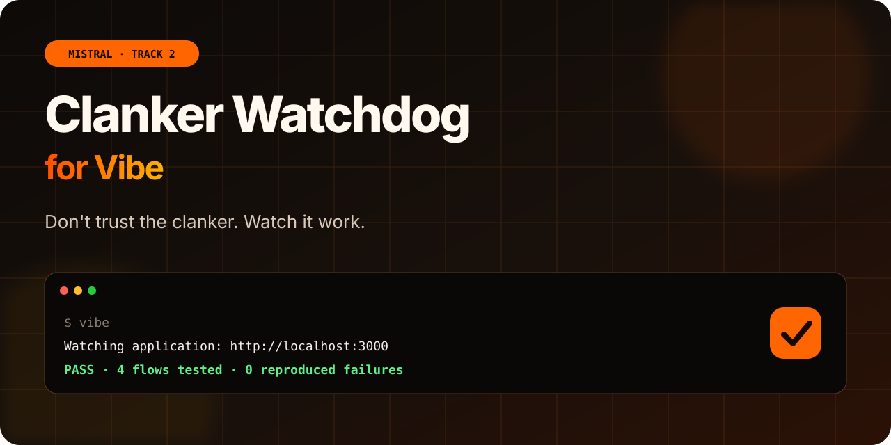
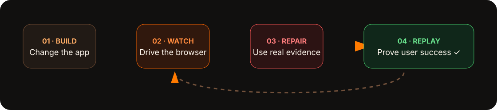
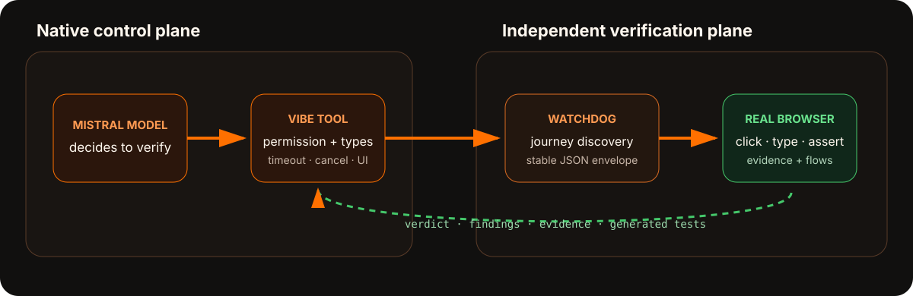
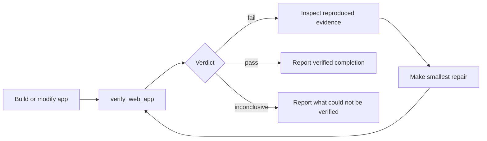

<p align="center">
  
</p>

<p align="center">
  <strong>Don't trust the clanker. Watch it work.</strong><br>
  A native browser acceptance verifier for Mistral Vibe.
</p>

<p align="center">
  <a href="#the-90-second-demo"><strong>See the demo</strong></a>
  ·
  <a href="#what-we-added-to-vibe">Native tool</a>
  ·
  <a href="#architecture">Architecture</a>
  ·
  <a href="#run-the-fork">Run the fork</a>
</p>

<p align="center">
  
  
  
  <a href="LICENSE"></a>
</p>

---

## Vibe can write the feature. Now it can prove the journey.

Coding agents are excellent at reading source, changing files, and running unit
tests. But users do not experience source code. They experience a browser:
clicking buttons, submitting forms, navigating between pages, and expecting
state to remain correct.

This fork adds `verify_web_app` as a **native, typed, permissioned Vibe tool**.
When Vibe believes a web task is complete, it can launch Clanker Watchdog,
exercise the application through real browser journeys, inspect only reproduced
failures, repair the source, and replay the saved regression flow.

> **Vibe used to stop at code completion. This fork makes it stop at verified
> user success.**

<p align="center">
  
</p>

## The 90-second demo

The demo uses a deceptively simple Gearloop defect: adding an item succeeds, but
the cart badge stays stale.

| Moment | What the judge sees | What it proves |
| --- | --- | --- |
| **Build** | Vibe finishes the feature and the code looks plausible. | Static completion is not acceptance. |
| **Watch** | Vibe chooses the native `verify_web_app` tool and requests approval. | Browser control is integrated and permissioned. |
| **Reproduce** | The badge failure is returned with steps, root cause, evidence, and a generated flow. | Findings are independently reproduced, not guessed. |
| **Repair** | Vibe reads the cited context and makes the smallest source change. | Evidence is actionable for the coding agent. |
| **Replay** | The saved flow turns green. | Completion is backed by a regression check. |

```text
> Is it actually done? Verify the user journey.

  Watching application: http://localhost:3000 (mid)
  FAIL · 4 flows tested · 1 reproduced failure

  HIGH  Cart badge remains stale
        Add an item → observe the header badge

> I reproduced the defect, repaired the stale state update, and replayed the
  generated flow.

  PASS · 4 flows tested · 0 reproduced failures
```

## What we added to Vibe

This is a Track 2 extension to the CLI itself—not a prompt wrapper and not only
a Skill.

| Native capability | Implementation |
| --- | --- |
| **Built-in discovery** | `VerifyWebApp` participates in Vibe's existing built-in tool registry and appears only when its executable is installed. |
| **Typed contract** | Pydantic models validate arguments, findings, verdicts, generated tests, and report paths. |
| **Model guidance** | A dedicated tool description tells the Mistral model when acceptance verification is appropriate. |
| **Explicit permission** | Vibe warns that a real browser may submit forms or mutate test data before execution. |
| **Terminal UX** | The call renders as “Watching application,” followed by flows tested, reproduced failures, and the verdict. |
| **Process safety** | Configurable timeout, cancellation cleanup, output limits, structured subprocess errors, and strict JSON parsing. |
| **Repair loop** | Evidence and generated Playwright flows stay in the target repository so Vibe can inspect and replay them. |

### Native tool contract

Vibe invokes:

```json
{
  "target_url": "http://localhost:3000",
  "effort": "mid"
}
```

Clanker Watchdog returns a stable machine-readable envelope:

```json
{
  "verdict": "fail",
  "summary": "The cart badge did not update after adding an item.",
  "flows_tested": 4,
  "findings": [
    {
      "title": "Cart badge remains stale",
      "severity": "high",
      "root_cause": "The mutation does not update the displayed count.",
      "repro_steps": ["Add an item", "Observe the header badge"],
      "evidence_path": ".clanker-watchdog/evidence/cart-badge.webm"
    }
  ],
  "generated_tests": [
    ".clanker-watchdog/flows/cart-badge/flow.mts"
  ],
  "report_path": ".clanker-watchdog/report.json"
}
```

Progress belongs on `stderr`; the single JSON result belongs on `stdout`. That
boundary keeps the terminal lively without making the tool contract fragile.

## Architecture

<p align="center">
  
</p>

1. The Mistral model decides the web task needs acceptance verification.
2. Vibe resolves the URL-scoped browser permission.
3. The native tool starts `clanker-watchdog` with Mistral as the provider.
4. The verifier explores and replays user journeys in a real browser.
5. Vibe receives only validated JSON: verdict, findings, evidence, and tests.
6. Vibe repairs reproduced defects and invokes the same tool again.

See [the detailed architecture and trust boundaries](docs/architecture.md).

## Run the fork

### Requirements

- Python 3.12+
- [`uv`](https://docs.astral.sh/uv/)
- A Mistral API key
- The `clanker-watchdog` executable on `PATH`, or an absolute executable path
- A web application running against safe test data

```bash
git clone https://github.com/m2moiz/clanker-watchdog-vibe.git
cd clanker-watchdog-vibe
uv sync --all-extras
uv run vibe --setup
uv run vibe
```

Configure the verifier in `~/.vibe/config.toml` when it is not already on
`PATH`:

```toml
[tools.verify_web_app]
permission = "ask"
executable = "/absolute/path/to/clanker-watchdog"
default_effort = "mid"
timeout_seconds = 900
```

Then open Vibe inside the target repository:

```text
Finish the cart feature, then verify the complete user journey at
http://localhost:3000. Fix only defects that Clanker Watchdog reproduces and
replay the saved flow before reporting completion.
```

> [!CAUTION]
> Browser verification can submit forms and change application data. Use a
> local or staging environment with disposable test accounts. Keep the default
> approval prompt enabled.

## Closed-loop behavior



The verifier is deliberately independent from Vibe's own reasoning. Vibe does
not award itself a pass; it consumes a result produced by an external browser
run.

## Verification and quality

The focused tool suite covers:

- typed pass and failure results;
- invalid targets and malformed JSON;
- browser permission context;
- non-zero subprocess exits;
- terminal verdict rendering.

Run the checks:

```bash
uv run pytest tests/tools/test_verify_web_app.py
uv run pyright
uv run ruff check .
uv run ruff format --check .
```

Current focused status: **6 tests passing**, with Pyright and Ruff passing for
the native tool change.

## Why Track 2

Track 2 asks builders to add a capability to Vibe. This fork adds a new
end-to-end ability at the tool boundary:

- Vibe can now experience the application it built.
- The Mistral model can decide when verification is warranted.
- The CLI owns permission, configuration, lifecycle, and result presentation.
- The external verifier specializes in browser execution and evidence.
- The generated regression flow becomes part of the agent's repair loop.

The result is a contained extension that follows Vibe's existing typed tool
architecture while changing when the agent considers work complete.

## Repository map

```text
vibe/core/tools/builtins/verify_web_app.py
    Typed native tool, permission resolution, process lifecycle, result UI

vibe/core/tools/builtins/prompts/verify_web_app.md
    Model-facing guidance for choosing browser verification

tests/tools/test_verify_web_app.py
    Contract, error, permission, and presentation tests

vibe/core/skills/builtins/vibe.py
    Built-in Vibe guidance updated for the new capability
```

## Built on Mistral Vibe

This project is a fork of
[`mistralai/mistral-vibe`](https://github.com/mistralai/mistral-vibe), Mistral's
open-source CLI coding assistant. The fork preserves the upstream architecture
and Apache 2.0 license while adding native acceptance verification.

## Team

Built by **Team Clanker Watchdog** for the Mistral AI Hackathon.

## License

Licensed under the [Apache License 2.0](LICENSE), consistent with upstream
Mistral Vibe.
