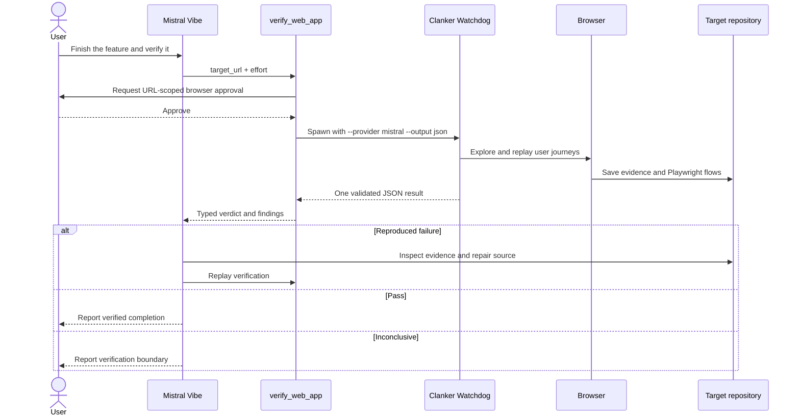

# Clanker Watchdog for Vibe: architecture

This note expands the trust boundaries and lifecycle behind the native
`verify_web_app` tool.

## Design principle

Vibe owns agent orchestration, permission, configuration, and repair. Clanker
Watchdog owns independent browser execution and evidence. The boundary between
them is one subprocess invocation and one strict JSON document.

## Component responsibilities

### Mistral Vibe

- decides when acceptance verification is relevant;
- asks the user before browser-driving actions;
- validates configuration and tool inputs;
- displays progress and the final verdict;
- uses reproduced evidence during repair.

### Native `verify_web_app` tool

- is discoverable only when the configured executable exists;
- accepts a fully qualified HTTP or HTTPS target;
- enforces typed effort values;
- bounds runtime and output size;
- terminates the child process on cancellation;
- translates subprocess and contract failures into Vibe `ToolError` messages;
- validates the final JSON against Pydantic models.

### Clanker Watchdog

- drives the browser independently from the coding agent;
- discovers and replays user journeys;
- saves evidence and generated tests inside the target repository;
- sends progress to `stderr`;
- sends exactly one stable result envelope to `stdout`.

## Trust boundaries

| Boundary | Control |
| --- | --- |
| User → browser mutation | Vibe's `ASK` permission and URL-scoped explanation |
| Vibe → executable | Availability check plus explicit configured path |
| Executable → Vibe | Strict JSON schema, output limit, timeout, and exit-code handling |
| Verifier → target app | Local or staging targets with disposable data |
| Finding → repair | Only independently reproduced findings enter the repair loop |

## Failure semantics

`pass` means the executed flows completed without a reproduced defect.
`fail` means at least one defect was reproduced and evidence was saved.
`inconclusive` means the verifier could not execute enough of the application to
make either claim.

An invalid executable response, timeout, cancellation, or non-zero process exit
is a tool execution error rather than an application verdict.
